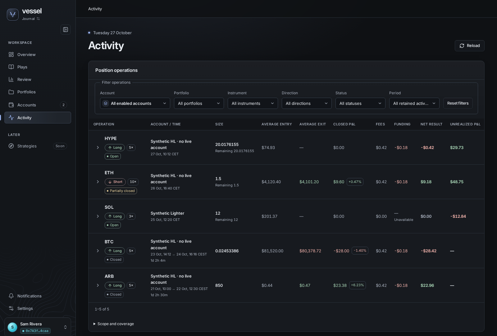
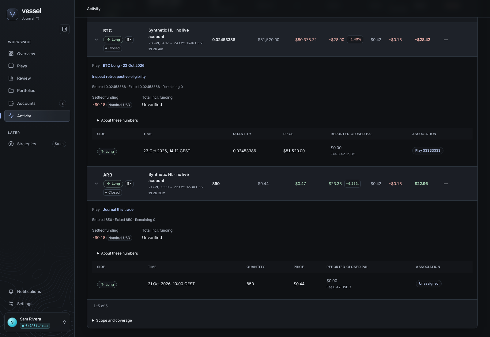
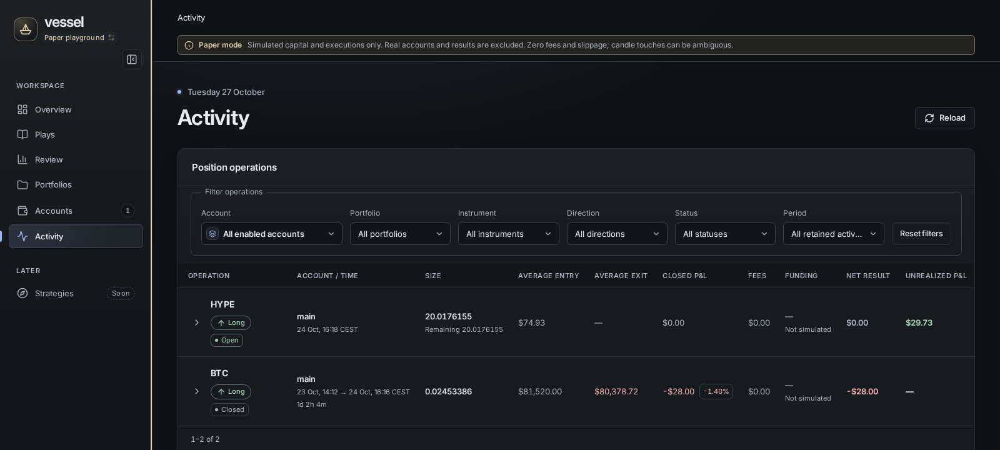

# Activity unrealized P&L: synthetic browser captures

October 27, 2026. The owner replaced the Activity table's Play column with
Unrealized P&L in both Journal and Paper modes; see the Unrealized P&L column
section of the [Activity operations contract](../../architecture/activity-operations.md).

Captures of the production frontend served by Vite, with Playwright-mocked
synthetic API responses: no database, venue, credential or owner data. Accounts
are visibly named "Synthetic HL · no live account" and "Synthetic Lighter".
Chromium headless shell, CSS viewport 1600×1100, Graphite, reduced motion,
Europe/Madrid display times.

| Capture | Shows |
| --- | --- |
|  | Journal: the HYPE long and the ETH short's remainder marked at the venue's current mark (`$29.73`, `$48.75`), the Lighter SOL long from the last refresh's venue-reported figure (`-$12.84`), and closed operations with "—". |
|  | Expanded rows: the linked Play's title as a link, and "Journal this trade" for a closed unassigned operation in place of its eligibility inspection. |
|  | Paper playground: the open simulated HYPE long marked at Hyperliquid's mark; the Play column is gone. |
