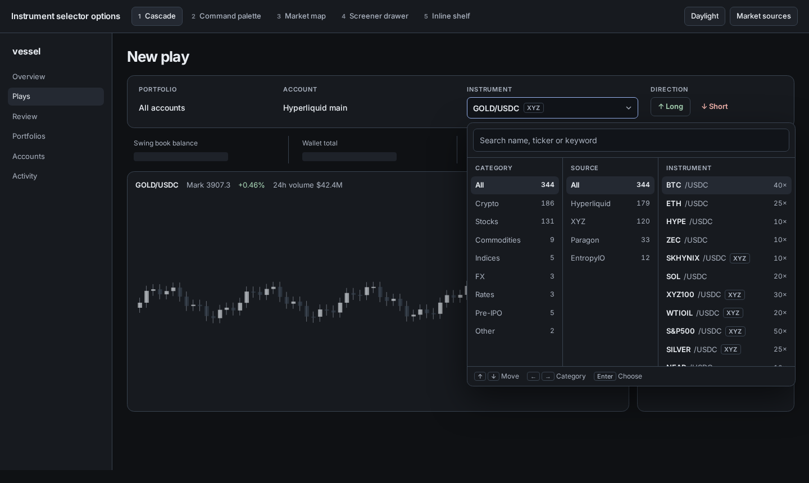
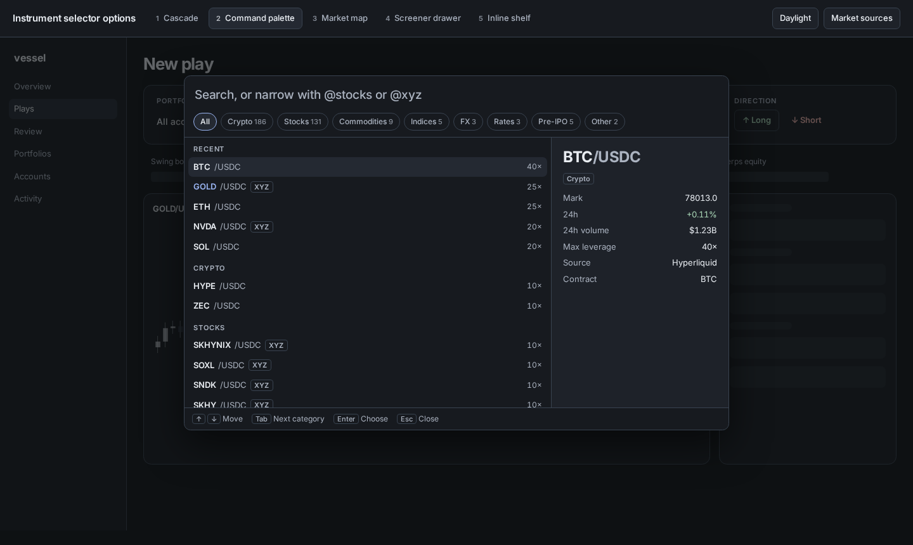
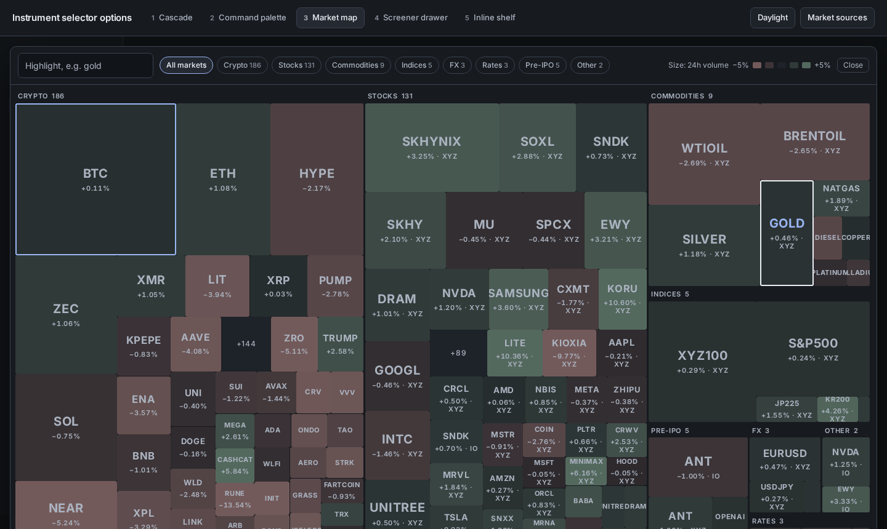
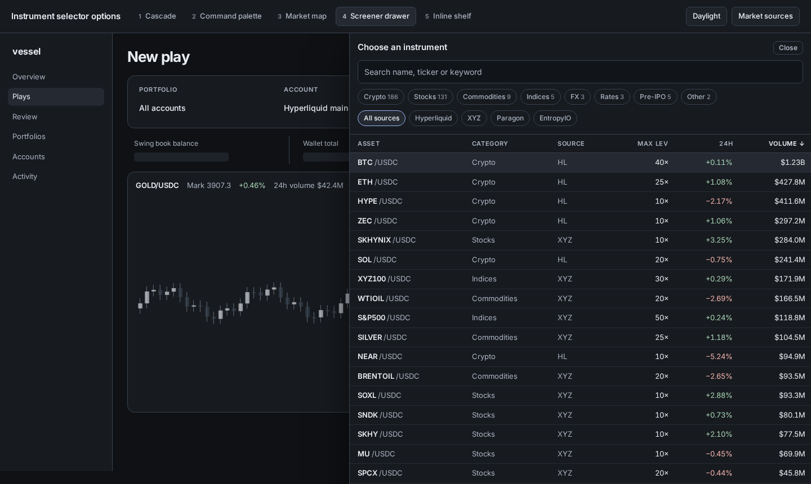
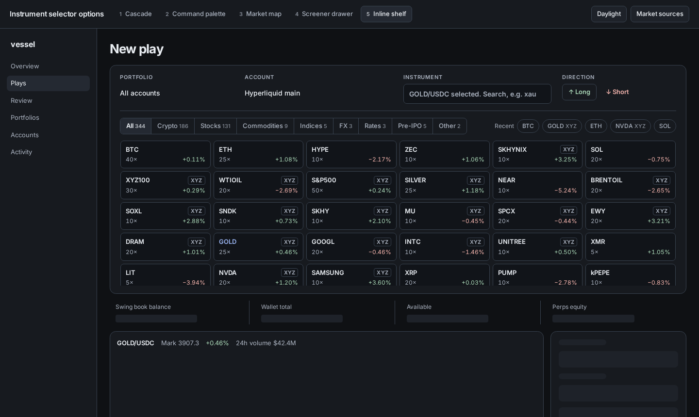

# Instrument selector options

> **Implemented** (November 2, 2026): option 1, Cascade, is in the app for every venue, and
> builder markets are supported. See [market-sources.md](../../architecture/market-sources.md),
> which also records one deviation: the field stays the search box. The rest of this page is
> the original comparison, kept as the record.

November 2, 2026. The owner found gold missing from the Hyperliquid instruments
and asked for a better selector with categories, shown as five radically
different designs and layouts before anything is built. This is a disposable
comparison; nothing is implemented in the app.

Open `prototype/instrument-selector.html` directly. It is self-contained apart
from the Inter web font, and embeds a static snapshot of Hyperliquid's public
`/info` API (345 active markets on November 2, 2026), so it makes no venue
requests. Recent instruments are sample data. Production must read venues
through the backend.

## Why instruments are missing

The catalogue reads only the primary DEX (`{ type: "meta", dex: "" }`). Gold is
`xyz:GOLD`, on a HIP-3 builder DEX. 166 of 345 active markets (48%) are invisible
to Vessel. Listing them is not enough: contract ID patterns reject `:`, and
candles, streams, market context, fills, orders, positions and funding are all
primary-only.

## Owner decisions so far

- Builder market sources can be enabled or disabled in configuration. The
  `meta` response has the same shape for every DEX, so one parser covers them.
- Disabling a source never removes a Play on one of its markets. The Play stays;
  new Plays cannot pick that market. The prototype's Market sources control and
  the notice under the instrument field show this.

Everything else waits for the owner's choice of selector.

## Options

| Option | Layout | Needs live market data? |
| --- | --- | --- |
| 1. Cascade | Popover under the field: Category, Source, Instrument columns | No, except ordering by volume |
| 2. Command palette | Centred, keyboard-first search with `@` scopes and a preview | Preview figures only |
| 3. Market map | Near full-page map sized by 24h volume, coloured by 24h move | Yes, for every enabled source |
| 4. Screener drawer | Right-hand drawer with a sortable table; the chart stays visible | For sorting by move or volume |
| 5. Inline shelf | No overlay; the context card grows in place | No, prices are optional |

| | |
| --- | --- |
|  |  |
|  |  |
|  | |

## Notes from the live data

- Hyperliquid annotates builder markets only (`perpConciseAnnotations`), so
  primary markets default to Crypto. A few builder markets have no annotation
  and appear as Other, including `io:NVDA`.
- Categories need normalizing: `fx`/`FX`, `stock`/`stocks`, and RISEx's
  `commodity` against Hyperliquid's `commodities`.
- 16 assets exist on more than one DEX, and display names can differ from the
  native ID (`xyz:SKHX` displays as SKHYNIX), so every option shows the source.
- The catalogue carries no prices today: live figures would come from one
  `metaAndAssetCtxs` read per enabled source.
