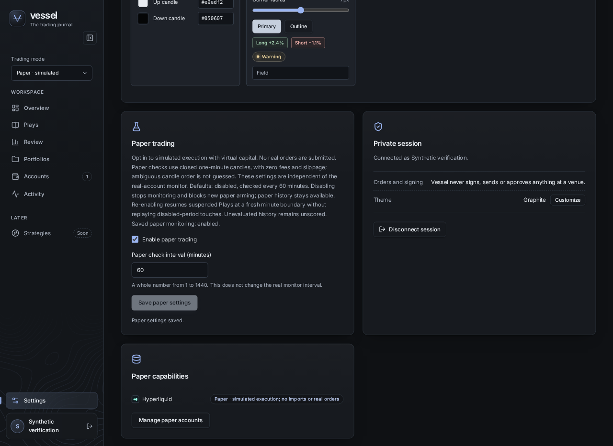
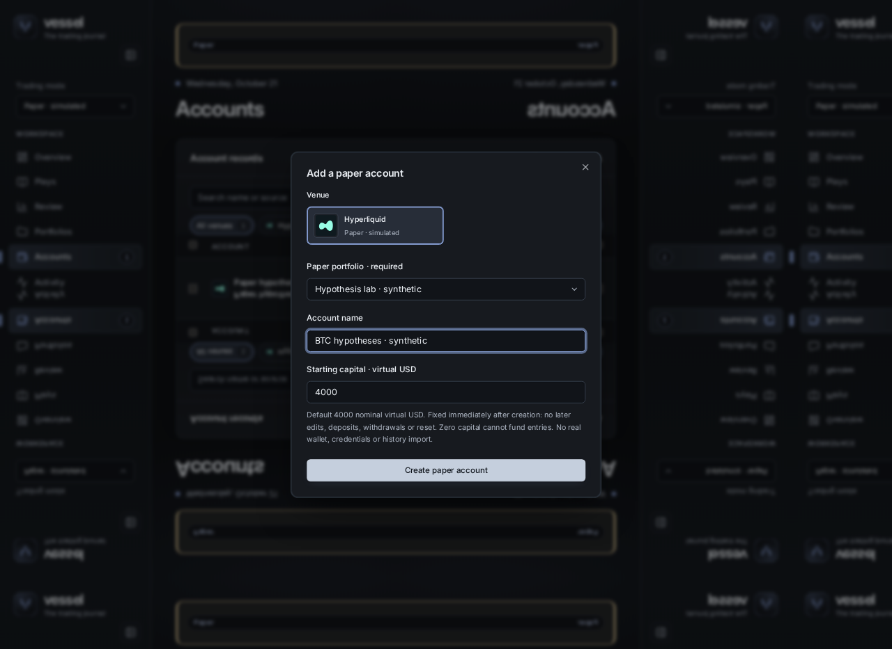
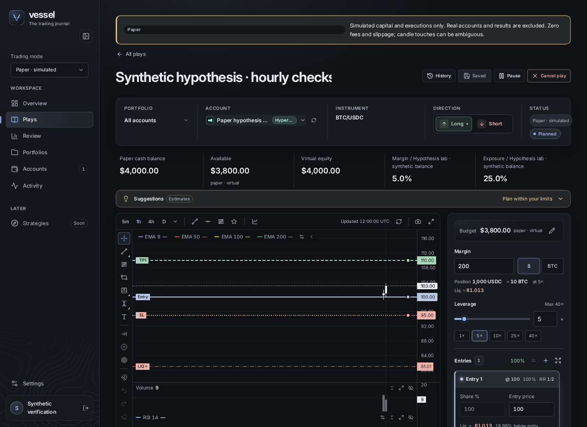
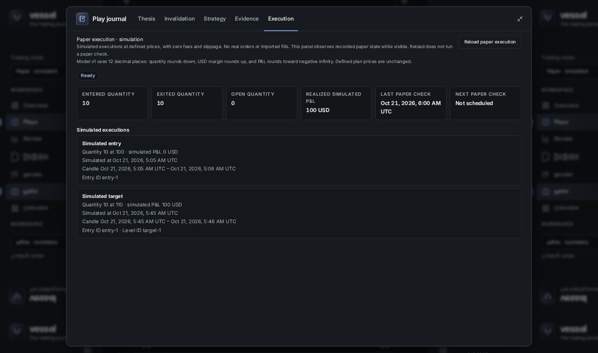
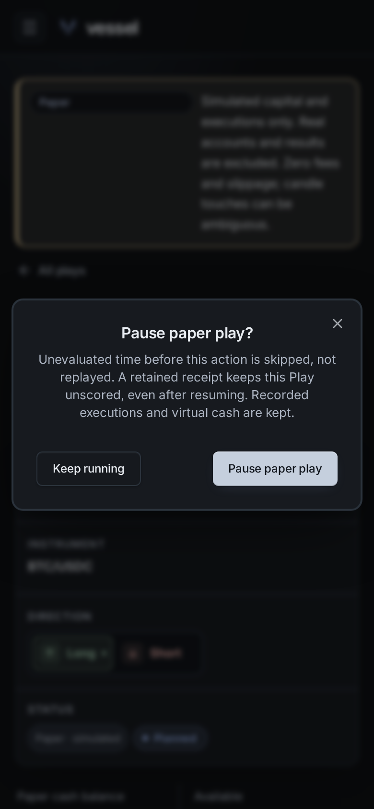

# Paper workflow screenshots

Captured October 21, 2026 for PR #32 from the production React components at
`9ae98af`, using the T3 browser in an isolated incognito profile.

**Synthetic UI examples only.** In-memory fixture APIs supplied all accounts,
capital, candles and simulated executions. These are independent illustrative
snapshots, not a continuous browser-to-API/worker/database test. No owner data,
wallet, credentials, live venue requests or database was used; no account was
created and no Play lifecycle write was made. The reviewed runtime is unchanged.

## 1. Enable Paper and choose its check interval

Paper is a separate opt-in setting. This example saves the default hourly
interval in the fixture and shows the Paper-only capability.

## 2. Set up a virtual account

The account form requires a Paper portfolio and shows Hyperliquid, the default
4,000 nominal virtual USD, and the creation-only capital restriction.
The filled form was captured without submitting it.

## 3. Plan in the existing Play workspace

The saved synthetic plan uses 200 USD margin at 5× leverage, an entry at 100,
a stop at 95 and a target at 110. The Paper banner and virtual capital context
remain separate from Real mode. Chart candles are synthetic, not live prices.

## 4. Inspect typed simulated executions

The expanded journal illustrates an entry and target exit for quantity 10,
with 100 USD simulated P&L. These facts were supplied directly by the fixture,
not generated by a worker during capture. Reload observes state; it does not
run a Paper check.

## 5. Confirm Pause and its scoring limitation

The mobile confirmation discloses skipped unevaluated time, retained recorded
cash/executions and permanently unscored history after resuming.
The confirmation was not submitted.

The accepted v1 limits and verification evidence remain in the
[delivery contract](../../../architecture/paper-trading-delivery-contract.md)
and [delivery state](../../../architecture/paper-trading-state.md).
