# Trading mode switch options

October 24, 2026. The owner asked to replace the component that switches between
Paper and Real: "something radically different, maybe a toggle button, but give
me more options to see what can fit better". This is a disposable comparison for
the owner to choose from; nothing is implemented in the app.

- Page: `prototype/trading-mode-switch.html`. It is self-contained (inline CSS
  and JS, the contour texture inlined, no requests), so open the file directly,
  or serve the repository root (`python3 -m http.server`) and open
  `/prototype/trading-mode-switch.html`.
- Every option is a live mini shell: sidebar, the sticky header with a
  breadcrumb and, in Paper, the one-line Paper strip (both being built
  separately and shown only for context), and a Plays list without Paper chips.
  Each has controls for Show Paper state, Collapse sidebar (icon rail) and Phone
  width (360px, off-canvas menu sheet). Below 560px the mock switches to the
  phone layout by itself.
- Global controls: **Simulate unsaved Play work** (every option then leads into
  one shared confirmation instead of `window.confirm`, and its control shows the
  pending choice), **Paper unavailable** (every control disappears and the
  sidebar returns to today's layout), and a Graphite/Daylight theme switch to
  show that everything is theme tokens.
- Data is synthetic. Graphite and Daylight values are copied from
  `frontend/src/features/settings/themes.ts`, derived tokens from
  `frontend/src/styles.css`.

## Owner decision

October 24, 2026: the owner chose **option 5, Brand lockup**, and asked for it
to be built. The app implementation stacks on the shell header and breadcrumb
work; the shared proposals below (Paper tone tokens, paper-boat icon, the in-app
confirmation, focus return and announcement, test helper, "Paper mode"/"Paper
playground" naming) apply to it.

## Today

`ApplicationShell.tsx` renders a "Trading mode" label over a `NativeSelect`
(Real, Paper · simulated) under the brand, only when Paper is enabled and
supported. Switching asks `window.confirm` when a Play draft is unsaved, then
remounts the shell in the other mode. The select works badly in the collapsed
rail and sits inside the off-canvas sheet on phones.

## Shared proposals

- **Paper tone**, derived only from theme tokens so every built-in, saved and
  customized theme follows: `--paper-ink: color-mix(in srgb, var(--warning) 72%,
  var(--muted-foreground))`, with `--paper-wash` (warning 9% over transparent),
  `--paper-glow` (22%) and `--paper-line` (warning 36% over `--border`). It reads
  as caution but quieter than real warnings. Using `--warning` itself is the
  simpler alternative. Add `--paper-ink` to the built-in readability checks.
- **Icons**: an anchor for Real (lucide `Anchor`) and a paper boat for Paper (a
  small custom icon beside `VesselMark`; lucide has no paper boat). Option 2
  shows a flask (`FlaskConical`) as the alternative.
- **Confirmation**: replace `window.confirm` with the app's alert dialog: title
  "Switch to Paper playground?" (or "Real journal"), the current message,
  "Keep editing" focused first, then "Discard and switch". The control shows the
  pending choice (dashed outline, the switch thumb half-way, the telegraph at
  Standby) and nothing changes until the answer.
- **Focus and announcement**: the shell is keyed by trading mode, so the control
  remounts. Return focus to the new control (or the menu trigger) and announce
  the new mode in the shell's existing polite live region.
- **Tests**: `PaperWorkspace.test.tsx` selects the `combobox` "Trading mode" six
  times (switching both ways, hidden when unsupported, and the unsaved-work
  prompt through a `window.confirm` spy). Whatever is chosen, add one
  `switchTradingMode(user, mode)` helper so only it knows the control, and move
  the prompt test to `alertdialog` "Switch to Paper playground?". The per-option
  query is listed below.
- **Naming**: Settings already has a light theme called "Paper". Copy should say
  "Paper mode" or "Paper playground", never just "Paper", where both can meet.

## Options

| # | Option | Where | Rail | Phone | Pattern | Clicks | Effort |
| --- | --- | --- | --- | --- | --- | --- | --- |
| 1 | Segmented control | Under the brand | Vertical icon pair | Menu sheet | Radio group | 1 | S |
| 2 | Paper mode switch | Under the brand | Pressed icon button | Menu sheet | Switch, toggle button in the rail | 1 | S |
| 3 | Workspace switcher | Replaces the brand | Tile opens the menu sideways | Top of the sheet, tile in the header | Menu button, `menuitemradio` | 2 | M |
| 4 | Environment pill | New top header | Not in the sidebar | In the header, no menu needed | Button with a popover dialog | 2 | M (plus the header) |
| 5 | Brand lockup | Brand subtitle and chrome | Swap button, edge rail | Sheet, "Paper" in the header | Button whose name states the action | 1 | S–M |
| 6 | Folder tabs | Sidebar top edge | Two mini icon tabs | Top of the sheet | Tabs, manual activation | 1 | M |
| 7 | Owner card menu | Owner card | Avatar badge, side menu | Bottom of the sheet | Menu button, `menuitem`, Alt+Shift+M | 2 or keys | M |
| 8 | Engine order telegraph | Sidebar bottom | Mini dial switch | Bottom of the sheet | Radio group, switch in the rail | 1 | L |

### 1 · Segmented control

Real | Paper with a sliding thumb under the brand; the most direct replacement.

- Component: a small `TradingModeSegments` (Radix `RadioGroup` or a plain
  radiogroup); thumb uses `--brand-line`/`--brand` for Real and
  `--paper-line`/`--paper-ink` for Paper over `--surface-sunken`.
- Rail: the two icons stack and the thumb slides down; names stay as visually
  hidden text with tooltips. Phone: full width in the sheet.
- A11y: `radiogroup` "Trading mode", radios "Real" and "Paper". Arrows move and
  select (standard radio behaviour, which remounts the workspace), Space selects.
- Tests: `user.click(getByRole('radio', { name: 'Paper' }))`.

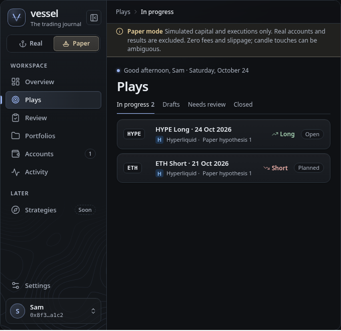
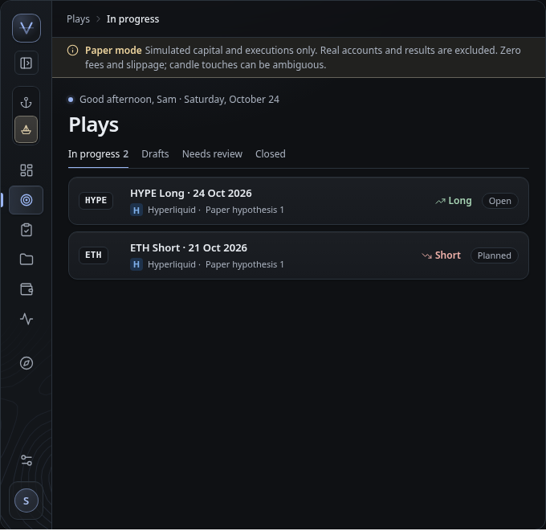

### 2 · Paper mode switch

A labelled "Paper mode" switch with a flask; Real is simply "off".

- Component: shadcn `Switch` in a row button; on state uses `--paper-*`.
- Rail: a toggle icon button (`aria-pressed`) named "Paper mode". Phone: the row
  in the sheet.
- A11y: `role="switch"` labelled by the visible "Paper mode", described by the
  state line. Space or Enter toggles. "Real" is never named, only implied.
- Tests: `user.click(getByRole('switch', { name: 'Paper mode' }))`.

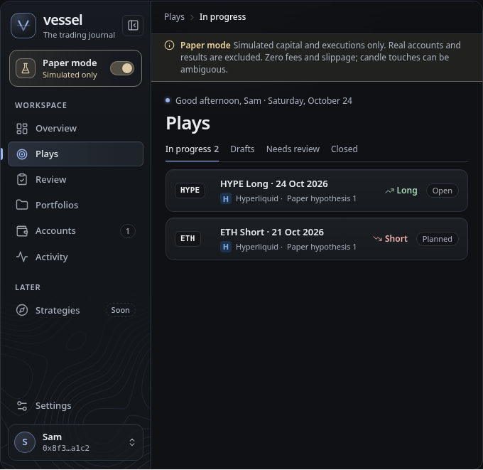
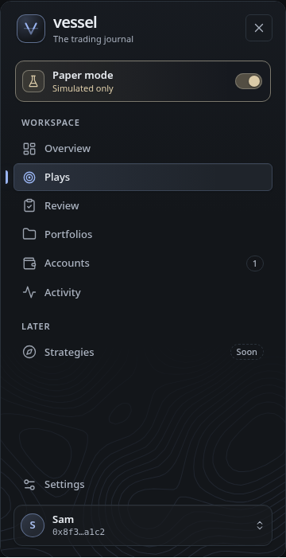

### 3 · Workspace switcher

The brand block becomes a Slack/Linear-style switcher: "Real journal" or
"Paper playground", with a menu that describes both.

- Component: Radix `DropdownMenu` with `RadioGroup`/`RadioItem`; mode tiles use
  the brand glow for Real (the Vessel mark) and the Paper tone (paper boat).
- Rail: the tile alone opens the menu to the side. Phone: the card heads the
  sheet and the header shows the mode tile. "Home" becomes only the Overview
  link.
- A11y: menu button "Real journal, trading mode" (`aria-haspopup="menu"`), menu
  "Trading mode" with two `menuitemradio` items and "Paper trading settings".
  Enter, Space or ↓ opens on the current mode; Escape returns focus.
- Tests: open `button` /^Real journal/, then `menuitemradio` "Paper playground".
- Paper unavailable: the plain brand and subtitle return.

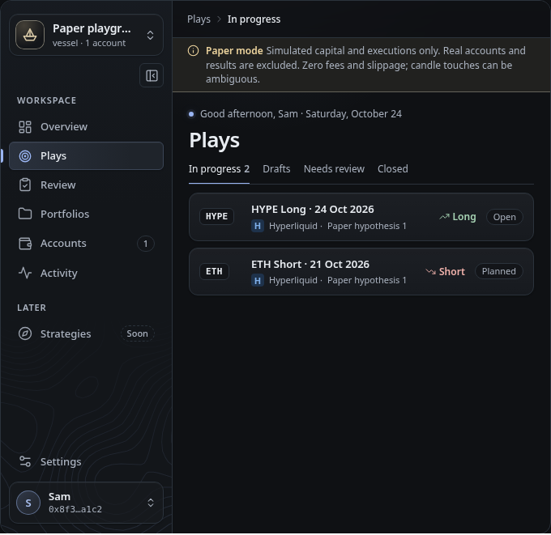
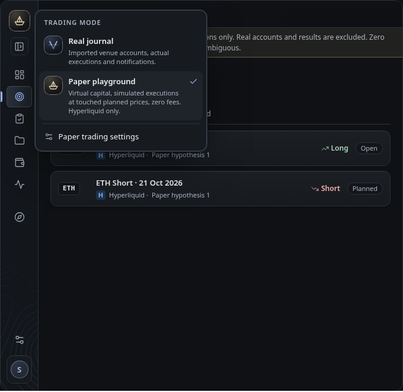

### 4 · Environment pill in the header

A `● Real` / `◐ Paper` pill at the right of the new sticky header, opening two
cards; the sidebar holds no control.

- Component: Radix `Popover` with two card buttons; depends on the header being
  built in parallel. Pill and cards use `--brand*` or `--paper-*`.
- Rail: unaffected. Phone: the same pill in the header beside the bell, cards
  stacked; visible without opening the menu.
- A11y: button "Real, trading mode" (`aria-haspopup="dialog"`); popover
  "Trading mode"; the current card is `aria-current` with "Current";
  descriptions via `aria-describedby`. Escape returns focus to the pill.
- Tests: click `button` "Real, trading mode", then `button` "Paper" (exact) in
  `dialog` "Trading mode".

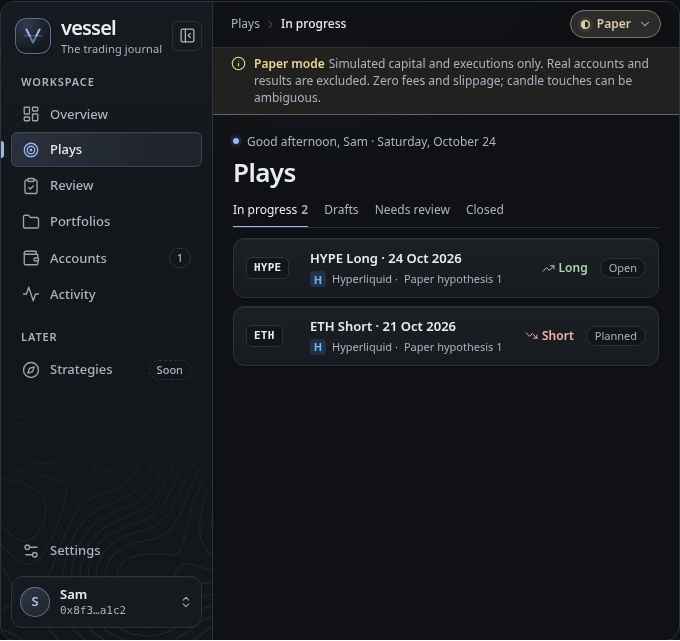
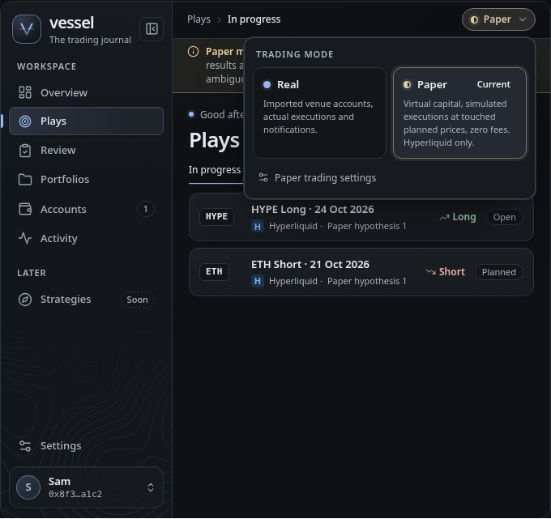
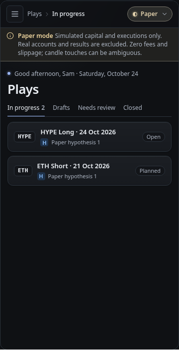

### 5 · Brand lockup

The subtitle under "vessel" names the mode and flips it; the hull sinks and a
paper boat rises, the contours take the Paper tone and a 2px rail runs down the
sidebar edge.

- Component: a button inside the brand; the mark stays the Overview link. The
  rail is `box-shadow: inset -2px 0 0 var(--paper-ink)`.
- Rail: a round swap button under the mark. Phone: the subtitle in the sheet and
  "Paper" beside the mark in the header (with the rail under the header).
- A11y: a plain button whose name states the action ("Real journal, switch to
  Paper playground"), not `aria-pressed`, because its label changes; announce
  the result. Hard to discover and easy to flip by accident.
- Tests: click `button` /^Real journal, switch to Paper/.

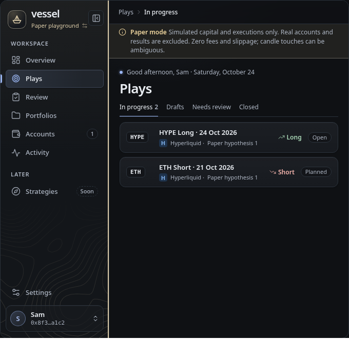

### 6 · Folder tabs

Two folder tabs on the sidebar's top edge; in Paper the navigation sheet becomes
faint graph paper (a 16px grid of `--paper-ink` at 9%).

- Component: Radix `Tabs` (manual activation) or a radiogroup with the same
  look; the sheet colour is `--sidebar` mixed with 4% `--warning`.
- Rail: two mini icon tabs. Phone: full-width tabs on top of the sheet.
- A11y: `tablist` "Trading mode", tabs "Real" and "Paper"; arrows move focus,
  Enter or Space switches; the workspace is the tab panel. Tabs promise an
  instant view change, so a radiogroup is the safer semantics.
- Tests: `user.click(getByRole('tab', { name: 'Paper' }))`.

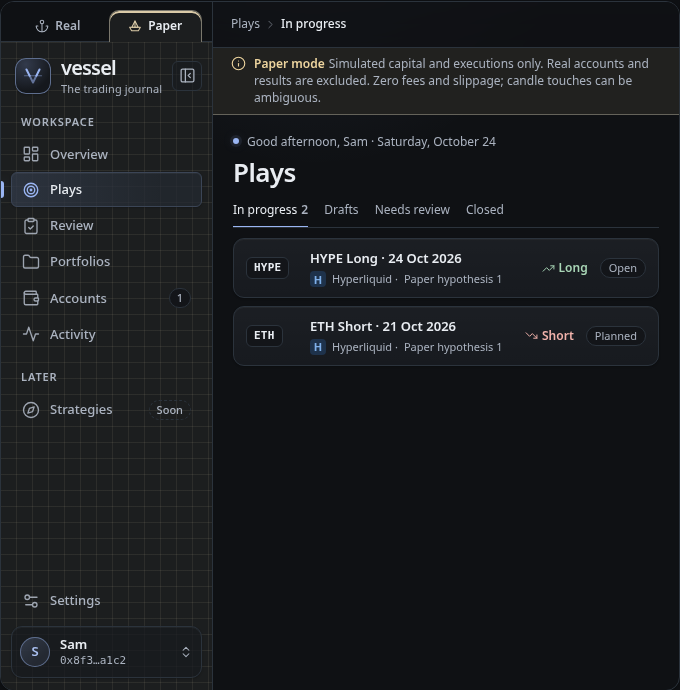
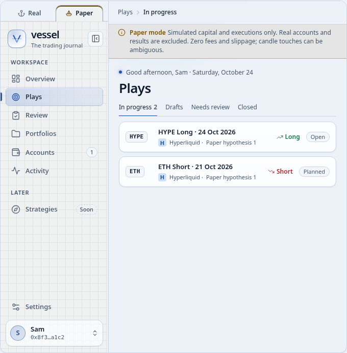

### 7 · Owner card menu

The owner card shows the mode under the name; its menu starts with "Switch to
Paper playground" and Alt+Shift+M; in Paper a 2px ring outlines the window.

- Component: extend `AccountMenu` (wallet mode) and turn the token-mode owner
  card, today a Disconnect button, into the same menu. The shortcut is
  document-level, ignored in text fields, and needs a conflict check.
- Rail: the avatar carries a mode badge and the menu opens to the side. Phone:
  bottom of the sheet; no shortcut on touch.
- A11y: menu button "Sam, Real journal, account menu"; the switch item has
  `aria-keyshortcuts="Alt+Shift+M"`. Least discoverable option.
- Tests: open `button` /account menu/, then `menuitem` "Switch to Paper
  playground".

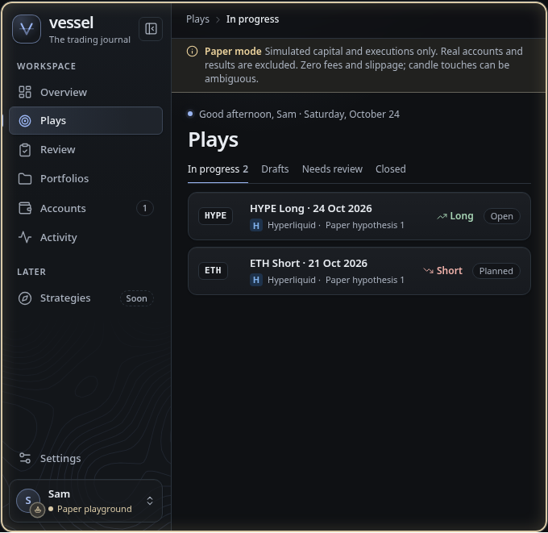
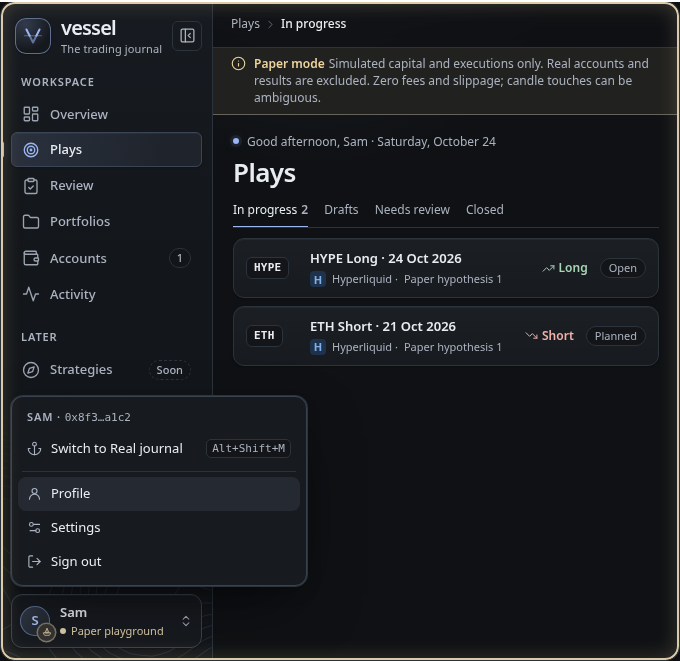

### 8 · Engine order telegraph

A ship's engine order telegraph at the foot of the sidebar: the lever swings
between Real and Paper and waits at Standby while the confirmation is open.

- Component: an SVG dial (face `--surface-sunken`, arcs `--brand` and
  `--paper-ink`, ticks `--muted-foreground`) under two radio buttons; the swing
  is a CSS transform, removed under reduced motion.
- Rail: a mini dial with `role="switch"` "Paper mode". Phone: the full dial at
  the bottom of the sheet. About 130px tall, far from the Paper strip.
- A11y: `radiogroup` labelled by the visible "Trading mode", radios "Real" and
  "Paper"; arrows throw the lever.
- Tests: `user.click(getByRole('radio', { name: 'Paper' }))`.

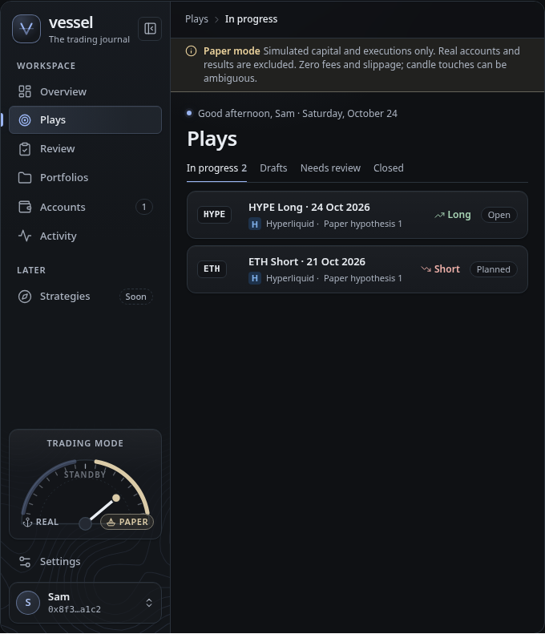
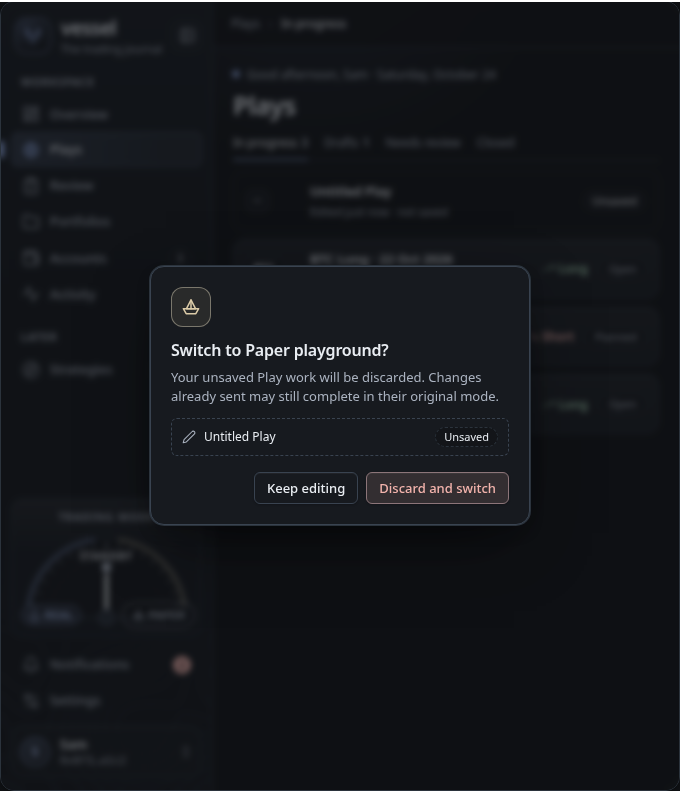

## Recommendation

A suggestion for the owner:

1. **4 · Environment pill.** Switching reloads a different workspace, which is
   what the environment pattern means. It is the only option visible on a phone
   without opening the menu, the rail does not affect it, and it sits directly
   above the Paper strip, so control and explanation read together while the
   sidebar loses a control. It waits for the new header and takes two clicks,
   which suits a rare, workspace-wide change.
2. **1 · Segmented control.** If a one-click toggle in the sidebar is preferred:
   both modes named, a clean rail form, the smallest change from today and the
   cheapest to build and test.

Either works with the paper-boat icon; option 5's mark change could be added
later for ambience.

## Verification

- Headless Chromium (Playwright 1.60 with the cached Chromium headless shell)
  at 1280, 728 and 390: no console errors or failed requests, no horizontal page
  overflow, the comparison table fits 728 without scrolling, and no sidebar or
  sheet overflows in expanded, rail or phone states.
- Scripted interactions at 728 and 390 (47 and 45 checks): radio arrows, the
  switch, both menus and the popover (open, arrows, Escape, focus return), tab
  manual activation and its panel label, Alt+Shift+M, the confirmation (focus on
  Keep editing, Escape cancels, Tab moves to Discard and switch, confirming
  switches, focus returns), the telegraph's Standby state and Paper unavailable
  for all eight. Controls were found by role and the accessible names listed
  above.
- T3's browser at 728 and 390 against the served file: no console entries or
  overflow; the confirmation and the phone popover work.
- Captures here come from the same page at 728px with reduced motion.
